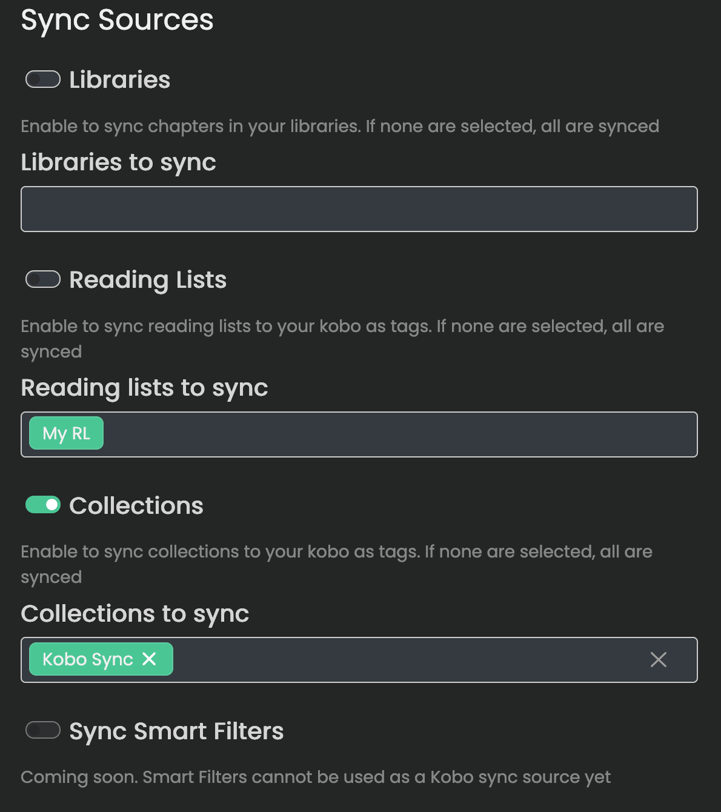
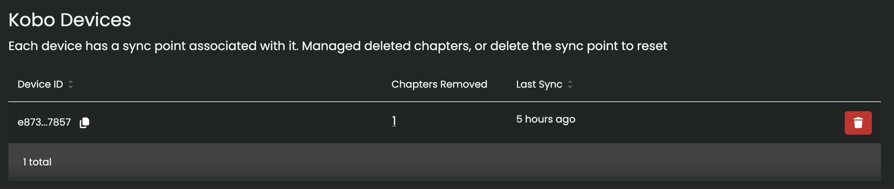
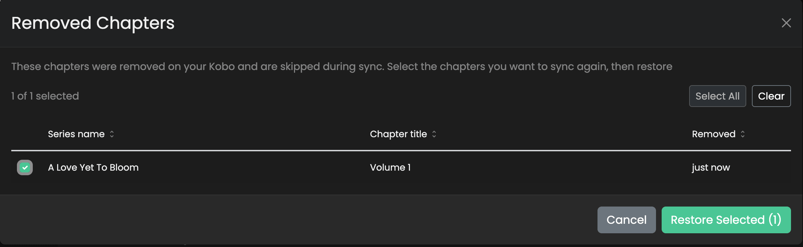

import { Callout } from 'nextra/components'
import { TagBadge } from '../../../components/TagBadge'
import { KavitaPlusBadge } from '../../../components/KavitaPlusBadge'

# Kobo Sync <TagBadge major={0} minor={9} patch={2} />

Kavita can be used as a sync server for your Kobo, taking over the role of the official Kobo servers.

## Features

- Sync epubs, archives, and image-based series/files to your Kobo
- Sync from libraries, collections, or reading lists
- Optional forwarding of requests to the Kobo Store when Kavita does not handle them
- Precise 2-way progress sync
- 1-way tag sync (Kavita Collections & Reading lists to Kobo Tags)
- 2-way annotation sync
- Recommendations <KavitaPlusBadge />


## Setup

<Callout type="warning">
    Kobo Sync can be turned off by an administrator with the [Enable Kobo Sync](/guides/admin-settings/general#enable-kobo-sync) server setting.
</Callout>

Before anything else set the [hostname](/guides/admin-settings/general#host-name) to ensure all requests reach your Kavita instance. This should be the same value as you'll use in the next step.

Connect your Kobo to your computer, and open `.kobo/Kobo/Kobo eReader.conf`. Under `[OneStoreServices]`, find or create the following line:

```
api_endpoint=https://storeapi.kobo.com
```

Then replace `https://storeapi.kobo.com` with your Kavita URL, followed by `/kobo/` and your Auth key:

```
api_endpoint=https://kavita.example.com/kobo/<AuthKey>
```

See [Auth key](/guides/user-settings/3rdpartyclients#auth-key) for how to find yours.

<Callout type="warning">
    It is recommended to only use Kobo Sync over https!
</Callout>

To stop using Kavita, set the line back to `api_endpoint=https://storeapi.kobo.com`.

### Kepubify

Epubs are automatically converted to kepubs when downloaded on your Kobo. Kavita ships with the `kepubify` binary to do this. An administrator may provide a custom binary with the [Kepubify Path](/guides/admin-settings/general#kepubify-path) server setting.

If you're using non-root Docker, Kavita cannot execute the shipped binary, and you'll need to ship your own or fix the permissions with an init container.

<Callout type="warning">
    On `linux-musl`, you must provide your own `kepubify` binary.
</Callout>

## Preferences

Kobo Sync preferences are set per user, and can be found on the Account > Kobo Sync settings page.

### Sync Preferences

To prevent your Kobo from having to load *ALL* your books, you can restrict syncing to specific libraries, reading lists or collections.
You can decide to sync all or only a selection for each source. Reading lists and collections will also be synced to your Kobo as tags.

Smart filters will be supported in the future!

<Callout type="warning">
    We recommend against syncing all chapters to keep the amount manageble on your Kobo
</Callout>



### Sync Item Limit

The maximum number of items sent to your Kobo per sync request, between 25 and 100. Default: `100`

### Forward to Kobo Store

Default: `Enabled`

Requests for books outside your Kavita library are forwarded to the official Kobo Store. Disable this to stop your Kobo from talking to Kobo's servers.

### Progress Sync

Progress for epubs always syncs to the right chapter. When kepubify is available, the position inside the chapter is synced on a best-effort basis.

Progress you make in Kavita's reader reaches your Kobo about 5 minutes later, at its next sync or when the book is opened.

### Annotation sync

Annotations for chapters are synced between Kavita and Kobo.

### Recommendations <KavitaPlusBadge /> [#recommendations]

Recommendations only show up on your Kobo when syncing a collection. For each recommended series not yet in your collection, Kavita sends the first book.
If you want to read it, click add/restore on your Kobo: the series is added to your collection, and all of its books are synced to your Kobo.

<Callout type="warning">
    The management collection must be configured for recommendations to show up
</Callout>

## Sync points

Each Kobo gets a sync point associated with it. This remembers which chapters, progress, and tags were last synced to the device.



To force a completely new sync, you can delete one here.

### Restore removed books

Any books you've removed on your Kobo are stored in the sync point and can be restored here


